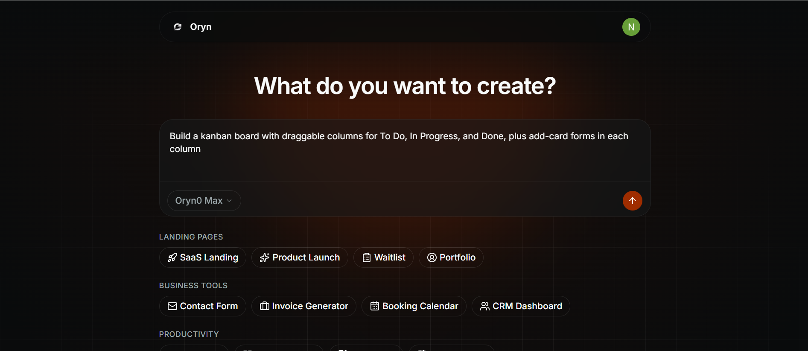
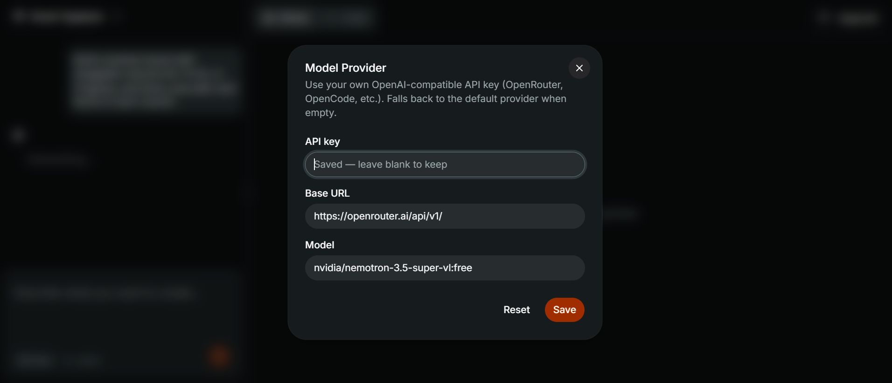
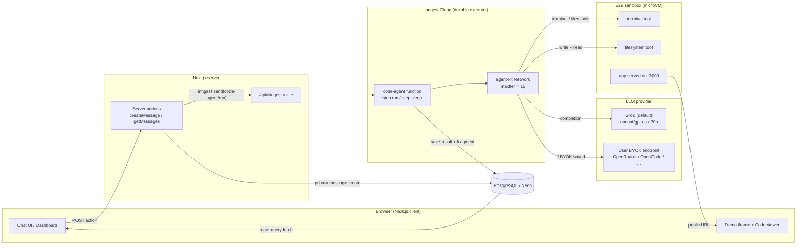
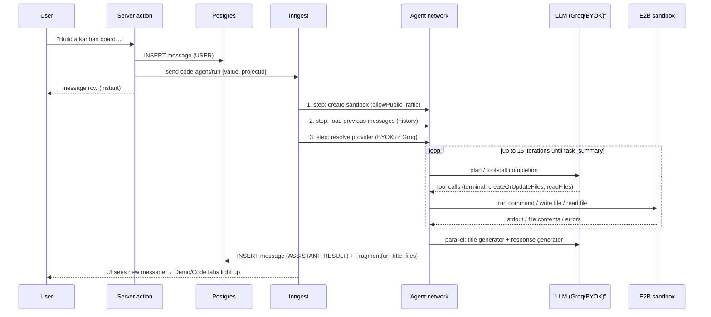
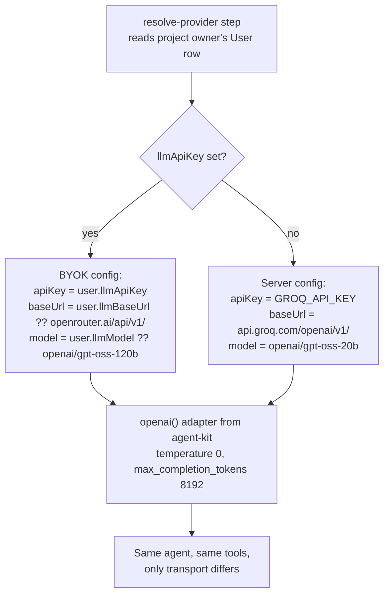
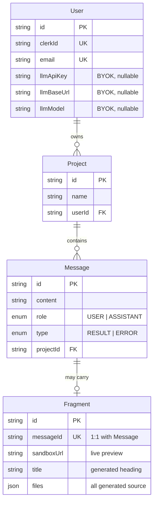

# Oryn

**Prompt in. Working web app out.**

Oryn is an AI coding-agent platform: you describe a web app in plain English, an autonomous agent writes the code inside a disposable cloud sandbox, and you get a live, shareable preview plus the full source — no local toolchain, no setup.

<p align="center">
  
</p>

---

## Table of contents

- [Screenshots](#screenshots)
- [What it does](#what-it-does)
- [Real-life use cases](#real-life-use-cases)
- [Tech stack](#tech-stack)
- [Architecture](#architecture)
  - [High-level data flow](#high-level-data-flow)
  - [Agent run, step by step](#agent-run-step-by-step)
  - [Provider resolution (Groq + BYOK)](#provider-resolution-groq--byok)
  - [Database schema](#database-schema)
- [Key concepts explained](#key-concepts-explained)
- [Project structure](#project-structure)
- [Local development](#local-development)
- [Environment variables](#environment-variables)
- [Deployment](#deployment)
- [Security notes](#security-notes)

---

## Screenshots

### 1. Dashboard

<p align="center">
  
</p>

The entry point. A single prompt box — *"What do you want to create?"* — plus one-click preset chips grouped by intent (Landing Pages, Business Tools, Productivity). A model selector lets you pick the reasoning tier before you spend a single token.

### 2. Project workspace (chat + live preview)

<p align="center">
  
</p>

Split view. Left: the conversation — your prompts and the agent's responses stream in as the run progresses. Right: two tabs over the same result:

- **Demo** — the generated app running live inside an iframe, straight from the sandbox
- **Code** — the generated source with a file explorer and syntax-highlighted viewer

### 3. BYOK — Model Provider dialog

<p align="center">
  
</p>

Bring Your Own Key. Drop in any OpenAI-compatible endpoint (OpenRouter, OpenCode, a local Ollama, your corporate gateway), and every agent run for your projects uses *your* key, *your* base URL, *your* model. Leave it empty and the platform falls back to the default server-side Groq provider.

---

## What it does

1. **You describe an app** — "Build a kanban board with draggable columns", "SaaS landing page with pricing table".
2. **An agent loops until done** — it plans, writes files, shells out to install dependencies, reads errors, and fixes them — up to 15 iterations — inside an isolated E2B microVM.
3. **You get a live preview** — the sandbox serves the built app on a public URL rendered in the workspace's Demo tab.
4. **You get the source** — every generated file is persisted with the result and browsable in the Code tab.
5. **You iterate in chat** — "add dark mode", "change the palette" — and a fresh sandbox + preview is produced for the new version.

---

## Real-life use cases

| Who | Why they use Oryn |
|---|---|
| **Non-developers / founders** | Validate a landing-page or waitlist idea in minutes without hiring anyone or touching npm. |
| **Freelance designers & marketers** | Turn a client brief ("invoice generator with CSV export") into a clickable prototype for sign-off before writing production code. |
| **Product teams** | Spike internal tools — dashboards, booking forms, CRM shells — and demo them live in a standup instead of sharing screenshots. |
| **Developers (fast scaffolding)** | Skip boilerplate. Let the agent generate the first working version of a CRUD app or auth flow, then pull the code and own it. |
| **Teachers & workshops** | Students describe an idea and watch code materialize into a running app — a concrete, observable feedback loop for learning web dev. |
| **Hackathons** | Build the front-end of three ideas in an hour, pick the one that feels best, keep the source. |
| **Agencies** | Produce interactive mockups for pitches the same day the brief lands. |

Common thread: **the cost of an idea drops to one sentence**. No repo, no build tooling, no deployment step between thought and something you can click.

---

## Tech stack

| Layer | Choice | Role |
|---|---|---|
| Framework | **Next.js 16** (App Router, Turbopack, React 19) | UI, server actions, API routes |
| Auth | **Clerk** | Sign-in/sign-up, session → user mapping |
| Database | **PostgreSQL (Neon)** + **Prisma 7** | Users, projects, messages, fragments |
| Agent runtime | **Inngest** (durable execution) + **@inngest/agent-kit** | Event-driven agent runs that survive retries |
| LLM | **Groq** (`openai/gpt-oss-20b`) default; any **OpenAI-compatible** endpoint via BYOK | Code generation, titles, responses |
| Sandboxes | **E2B** (code-interpreter SDK, custom template) | MicroVM per run: terminal, filesystem, live preview |
| Styling | **Tailwind CSS 4** + shadcn-style components + `lucide-react` icons | Dark, dense, IDE-like UI |
| State | **TanStack React Query** | Server-state caching for messages/settings |
| Markdown/streaming | `streamdown`, `@inngest/ai-elements`, `shiki` | Rendered assistant output, syntax highlighting |
| Hosting | **Vercel** + **Vercel Git integration** | Preview deploys per push |

---

## Architecture

### High-level data flow



**Reading the diagram:** every user message takes exactly two hops out of the browser — one server action writes the message to Postgres and fires an Inngest event; the agent function then owns the entire run. The agent never talks to your browser. When it finishes, the result (reply text, generated files, preview URL) is a new database row, which the UI polls through React Query and renders. The preview iframe points directly at the sandbox's public host.

### Agent run, step by step



**What makes this durable:** every numbered stage above is an Inngest `step.run`. If the platform crashes mid-run, Inngest replays the function and *skips steps that already completed* — the sandbox isn't recreated, history isn't re-fetched, the provider isn't re-resolved. The expensive, non-idempotent parts happen once.

### Provider resolution (Groq + BYOK)



Because agent-kit's `openai()` adapter accepts an arbitrary `baseUrl`, any OpenAI-compatible chat endpoint plugs in without code changes — that is the entire trick behind BYOK. The resolved config feeds the code agent **and** the two post-processing agents (fragment title, user-facing response), so one setting swaps the whole pipeline.

### Database schema



**Design notes:**

- `Fragment` is 1:1 with `Message` (`messageId @unique`) — one assistant reply carries exactly one build artifact.
- `files` is a JSON blob of `{path: content}` — simple, atomic, and enough for the Code tab; no need to normalize generated code into rows.
- `Message.type = ERROR` is how a failed run surfaces in chat ("Something went wrong…") instead of throwing away the conversation.
- BYOK columns live on `User`, not `Project` — one key covers all of a user's projects.

---

## Key concepts explained

**Durable execution (Inngest).** The agent function is not a long-running process on your server. Inngest executes it step by step in the cloud; each `step.run` is memoized by step ID. Long waits are `step.sleep`, not `setTimeout`. This is why a 5-minute agent run costs zero server compute while idle and survives deploys.

**Agent network (agent-kit).** `createNetwork` wraps a single agent with a router. The router re-invokes the agent until `network.state.data.summary` is populated — the agent emits `<task_summary>` only when it believes the job is done. `maxIter: 15` is the hard stop against runaway loops.

**Three tools, one sandbox.** The agent's entire hands-on capability is:
1. `terminal` — run any command (installs, builds, tests), stdout/stderr streamed back
2. `createOrUpdateFiles` — write files, mirrored into network state
3. `readFiles` — inspect what exists

Everything else (planning, deciding, fixing) is the LLM. The sandbox is deliberately dumb.

**E2B sandbox lifecycle.** One microVM per run, created from a pinned template (`wnopgcecqyx7d1q6qq0u`) with `allowPublicTraffic: true` so the preview URL loads without auth headers. The app the agent builds runs on port 3000 inside the VM; `sandbox.getHost(3000)` yields the public hostname stored in `Fragment.sandboxUrl`.

**Two-phase completion.** After the main loop, two cheap agents run in parallel over the final summary: one invents a short fragment title, one writes the chat reply. The raw summary never reaches the user.

**Provider-agnostic transport.** Groq and BYOK are the same code path with different credentials — proven by the fact that migrating from Gemini to Groq was a `baseUrl` + model change, not a rewrite.

---

## Project structure

```
oryn/
├── prisma/
│   ├── schema.prisma            # User / Project / Message / Fragment
│   └── migrations/              # including user_llm_provider (BYOK columns)
├── prisma7.config.ts            # Prisma 7 config (loads DATABASE_URL)
├── src/
│   ├── app/
│   │   ├── (auth)/              # Clerk sign-in / sign-up
│   │   ├── (root)/              # dashboard + /projects/[id] workspace
│   │   └── api/inngest/         # Inngest event handler endpoint
│   ├── components/
│   │   ├── projects/            # chat, file explorer, code view,
│   │   │                        # preview iframe, Model Provider dialog
│   │   └── ai-elements/         # markdown response renderer
│   ├── features/
│   │   ├── auth/                # getCurrentUser, onboarding
│   │   ├── messages/            # createMessage / getMessages actions
│   │   ├── projects/            # project CRUD actions
│   │   ├── settings/            # BYOK get/save/clear actions + hooks
│   │   └── inngest/
│   │       ├── client.ts        # Inngest client
│   │       ├── functions.ts     # code-agent function, tools, network
│   │       └── utils.ts         # sandbox connect + output helpers
│   ├── lib/
│   │   ├── db.ts                # Prisma singleton (adapter-pg)
│   │   └── prompt.ts            # system / title / response prompts
│   └── generated/prisma/        # prisma generate output (gitignored)
├── ss/                          # README screenshots
└── patches/                     # bun patch for @inngest/agent-kit
```

---

## Local development

Requirements: **Bun 1.4+**, a **Neon** (or any Postgres) database, **Clerk** keys, an **E2B** API key, a **Groq** API key, and the **Inngest** CLI.

```bash
# 1. Install
bun install

# 2. Configure
cp .env.example .env    # then fill every key (see table below)

# 3. Create DB schema + generate client
npx prisma migrate dev
npx prisma generate

# 4. Run the app (terminal A)
bun run dev             # http://localhost:3000

# 5. Run the Inngest worker (terminal B) — required for agent runs
npx inngest dev         # proxies events to /api/inngest
```

> `prisma generate` also runs automatically as part of `bun run build`, so a fresh clone never hits the "generated client missing" build error.

### Verify an agent run

Open a project, send a prompt, and watch two consoles:

- **Inngest dev UI** — step timeline: `get-sandbox-id` → `get-previous-messages` → `resolve-provider` → tool steps → `get-sandbox-url` → `save-result`
- **Next.js terminal** — `[code-agent] using BYOK provider …` or `[code-agent] no BYOK key, falling back to server Groq`

---

## Environment variables

| Variable | Required | Purpose |
|---|---|---|
| `DATABASE_URL` | ✅ | Postgres connection string (Neon) |
| `NEXT_PUBLIC_CLERK_PUBLISHABLE_KEY` | ✅ | Clerk client |
| `CLERK_SECRET_KEY` | ✅ | Clerk server |
| `NEXT_PUBLIC_CLERK_SIGN_IN_URL` | ✅ | `/sign-in` route |
| `NEXT_PUBLIC_CLERK_SIGN_IN_FALLBACK_REDIRECT_URL` | ✅ | post-login redirect |
| `NEXT_PUBLIC_CLERK_SIGN_UP_FALLBACK_REDIRECT_URL` | ✅ | post-signup redirect |
| `E2B_API_KEY` | ✅ | sandbox creation |
| `GROQ_API_KEY` | ✅ | default LLM provider |
| `INNGEST_DEV` | dev only | `1` routes events to local Inngest dev server; **omit in production** (use `INNGEST_EVENT_KEY` + `INNGEST_SIGNING_KEY` for Inngest Cloud) |
| `GEMINI_API_KEY` | — | legacy, unused after Groq migration |

BYOK keys are **not** environment variables — users supply them at runtime through the Model Provider dialog; they are stored per-user in the `users` table.

---

## Deployment

Deployed on **Vercel** with the Git integration: pushes to `main` build production, other branches build previews.

```bash
vercel link                 # once — links the repo
git push                    # every push = a deployment
```

Build pipeline notes (learned the hard way):

1. `build` script is `prisma generate && next build` — the generated client is gitignored, so generation must happen on the build machine.
2. All runtime env vars must exist in Vercel (`vercel env add NAME --environment production,preview --value …`) — Next.js 16 collects page data at build time and `db.ts` fails fast on a missing `DATABASE_URL`.
3. Preview deployments are protected by Vercel Authentication by default — viewers must be logged in to the Vercel account.

---

## Security notes

> ⚠️ **BYOK keys are stored in plaintext** in the `users` table (`llmApiKey`). This is acceptable for a prototype but **must be encrypted at rest** (e.g. envelope encryption with a KMS-managed data key) before handling untrusted or production traffic. Treat `DATABASE_URL` compromise as full key compromise until then.

Other hardening already in place:

- Every server action re-validates `getCurrentUser()` and row ownership (`userId` match) before reading or writing.
- Sandboxes are single-use microVMs — no cross-tenant filesystem access; `allowPublicTraffic` exposes only the sandbox's own ports.
- Clerk secret keys and provider keys never ship to the client bundle.

---

## License

Private / all rights reserved unless otherwise stated.
